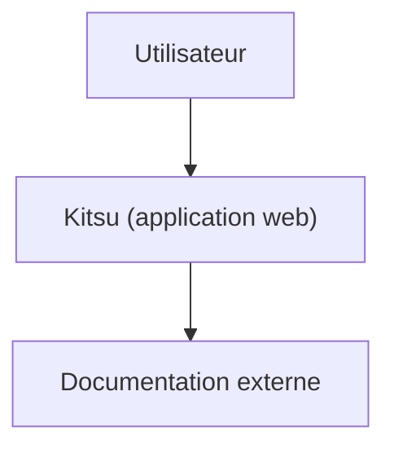

# cgwire/kitsu

> Plateforme web de collaboration pour studios d'animation, d'effets visuels et de jeu vidéo.

## Le problème
Les équipes de production créative peinent à communiquer et à suivre les livraisons.

## Ce que ça fait vraiment
Application web de suivi de production et de collaboration entre parties prenantes. Le README renvoie à un site de documentation pour les fonctions et l'installation. Édité par CGWire (France), utilisé par plus de 300 studios.

## Comment c'est branché

Schéma simplifié d'après la fiche, sans diagramme fourni.

## Essayer
```bash
# Aucune commande documentée dans le README.
```

## Coût et pièges
Installation non documentée dans le README. Licence AGPL-3.0 : obligations en cas d'exposition réseau.

## Ce que ce n'est pas
Pas un outil de données ni d'IA : c'est un outil de gestion de production audiovisuelle.

## Alternatives
Aucune alternative nommée dans le README.

## Pour toi
Hors sujet pour un profil data / IA / MLOps : à ignorer.

