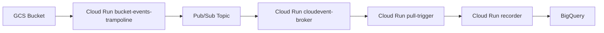

# chainguard-dev/terraform-infra-common

> Terraform modules and Go helpers to deploy Cloud Run services and event flows on GCP.

## The problem
Every team rewrites the same GCP building blocks: Cloud Run services, Pub/Sub, BigQuery recording, dashboards and alerts.

## What it actually does
About thirty Terraform modules cover Cloud Run, Pub/Sub, BigQuery, Cloud SQL, GKE, networking and monitoring. Some embed Go code built into an image and deployed by the module. Event flows go from a bucket to a CloudEvents broker and then to a BigQuery recorder. The Go packages `httpmetrics` and `memusage` help with instrumentation.

## How it is wired


## Trying it
```bash
provider "google" {
  project = var.project
}
```

## Cost and gotchas
A GCP project is required, and the deployed resources are billed. The repository is a copy pushed from a private repository: changes go through a review at Chainguard.

## What it is not
Not a portable framework: everything is tied to GCP. The module summary is delegated to `MODULES.md`, outside the README provided.

## Alternatives
No alternative named in the README.

## For you
Worth watching: a good model of a CloudEvents-to-BigQuery flow for data ingestion on GCP, but tied to this in-house design.
