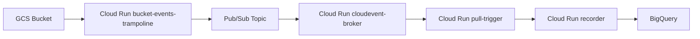

# chainguard-dev/terraform-infra-common

> Modules Terraform et aides Go pour déployer des services Cloud Run et des flux d'événements sur GCP.

## Le problème
Chaque équipe réécrit les mêmes briques GCP : services Cloud Run, Pub/Sub, enregistrement dans BigQuery, tableaux de bord et alertes.

## Ce que ça fait vraiment
Une trentaine de modules Terraform couvrent Cloud Run, Pub/Sub, BigQuery, Cloud SQL, GKE, réseau et surveillance. Certains embarquent du code Go construit en image et déployé par le module. Les flux d'événements vont d'un bucket à un broker CloudEvents puis à un enregistreur BigQuery. Les paquets Go `httpmetrics` et `memusage` aident à l'instrumentation.

## Comment c'est branché


## Essayer
```bash
provider "google" {
  project = var.project
}
```

## Coût et pièges
Projet GCP requis, les ressources déployées sont facturées. Le dépôt est une copie poussée depuis un dépôt privé : les changements passent par une relecture chez Chainguard.

## Ce que ce n'est pas
Pas un framework portable : tout est lié à GCP. Le résumé des modules est renvoyé à `MODULES.md`, hors README fourni.

## Alternatives
Aucune alternative nommée dans le README.

## Pour toi
À surveiller : bon modèle de flux CloudEvents vers BigQuery pour de l'ingestion de données sur GCP, mais lié à cette conception maison.

