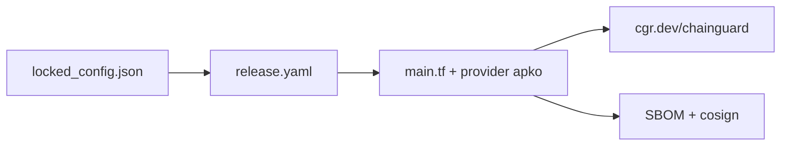

# chainguard-images/images

> Public build configurations of Chainguard's minimal, hardened OCI images, for container teams.

## The problem
Classic base images ship many unneeded packages, hence an attack surface and CVEs to carry around.

## What it actually does
Each image has an apko `locked_config.json` (pinned versions, reproducible), tests and a README. The `release.yaml` workflow builds via Terraform and the apko provider, and publishes to `cgr.dev/chainguard/` with SBOM and cosign attestations. The full catalog is commercial (Console).

## How it is wired


## Trying it
```bash
docker pull cgr.dev/chainguard/static:latest
docker pull cgr.dev/chainguard/nginx:latest
```

## Cost and gotchas
Public images are free; the full catalog goes through the Chainguard Console (commercial). The README does not detail the free tags.

## What it is not
Not a tool to install: it is the build repository, not the registry. Not the whole catalog.

## Alternatives
No alternative named in the README.

## For you
Worth watching: relevant for hardening the images of your MLOps services, but full access depends on a commercial account.
