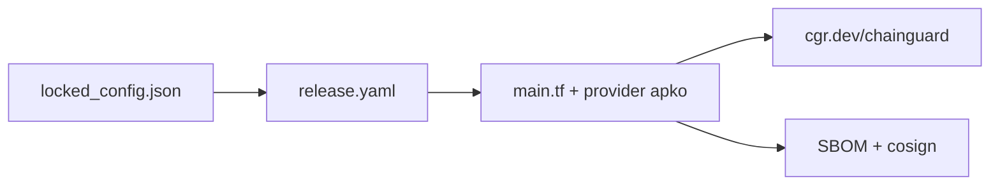

# chainguard-images/images

> Configurations de build publiques des images OCI minimales et durcies de Chainguard, pour équipes conteneurs.

## Le problème
Les images de base classiques embarquent beaucoup de paquets inutiles, donc une surface d'attaque et des CVE à traîner.

## Ce que ça fait vraiment
Chaque image a un `locked_config.json` apko (versions figées, reproductible), des tests et un README. Le workflow `release.yaml` construit via Terraform et le provider apko, publie sur `cgr.dev/chainguard/` avec SBOM et attestations cosign. Le catalogue complet est commercial (Console).

## Comment c'est branché


## Essayer
```bash
docker pull cgr.dev/chainguard/static:latest
docker pull cgr.dev/chainguard/nginx:latest
```

## Coût et pièges
Les images publiques sont gratuites ; le catalogue complet passe par la Console Chainguard (commercial). Le README ne détaille pas les tags gratuits.

## Ce que ce n'est pas
Ce n'est pas un outil à installer : c'est le dépôt de build, pas le registre. Ce n'est pas tout le catalogue.

## Alternatives
Aucune alternative nommée dans le README.

## Pour toi
À surveiller : pertinent pour durcir les images de tes services MLOps, mais l'accès complet dépend d'un compte commercial.

