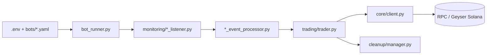

# chainstacklabs/pump-fun-bot

> Python bot that watches token creations on pump.fun and letsbonk.fun (Solana) and buys according to a configured strategy.

## The problem
Spotting and buying a token as soon as it is created requires listening to the chain continuously and building Solana transactions by hand. The repository also serves as educational material on this flow.

## What it actually does
Each YAML file in `bots/` defines an instance: a listener (geyser, logs, blocks or pumpportal), an exit strategy (`time_based`, `tp_sl`, `manual`) and priority fees. The `extreme_fast_mode` buys a fixed amount without reading the curve. `learning-examples/` contains standalone scripts (listeners, price calculation, manual buy/sell, decoding).

## How it is wired


## Trying it
```bash
uv sync
source .venv/bin/activate
uv pip install -e .
cp .env.example .env
pump_bot
uv run src/bot_runner.py
uv run learning-examples/verify_v2_account_layout.py
```

## Cost and gotchas
A private RPC/WSS node is required (public nodes cannot keep up), plus a wallet private key in `.env`. The README warns about scam bots in the issues that target private keys, and purchases cost fees even when they fail.

## What it is not
Not a production tool: the README says "NOT FOR PRODUCTION" and disclaims all liability. It guarantees no gains. The `pumpportal` listener only sees a sample of creations.

## Alternatives
- pumpfun-cli (same publisher): terminal interface to trade, launch and manage tokens.
- pumpclaw: agent skill that drives pumpfun-cli.

## For you
Ignore: it is a memecoin trading bot with an exposed private key, unrelated to data or MLOps; only the Solana learning scripts have occasional interest.
