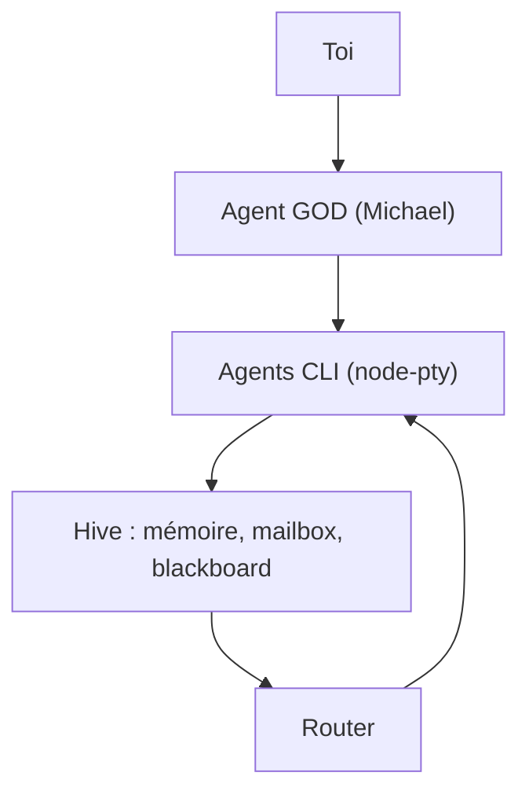

# chaitanyagiri/munder-difflin

> Desktop application that orchestrates several coding-agent CLIs like a team, with shared memory.

## The problem
Getting several terminal agents (Claude Code, Codex, Gemini...) to work together requires coordinating them by hand.

## What it actually does
An Electron app that launches each agent CLI in a `node-pty`, with markdown memory, file-based mailboxes and an orchestrator agent ("GOD", Michael) that routes tasks and only escalates spending or destructive operations. Pixi.js avatars represent the sessions. A paid Pro tier adds Capabilities, Stapler (dictation, meetings) and a sidebar.

## How it is wired


## Trying it
```bash
git clone https://github.com/chaitanyagiri/munder-difflin.git
cd munder-difflin
npm install
npm run dev
```

## Cost and gotchas
You need at least one agent CLI installed with its subscription or key. Pro: 150 USD per year after 24 October 2026 (free before). Official builds send anonymous usage events; opt-out is possible.

## What it is not
Not a programmable agent framework: it is a desktop application. The -37% token figure comes from a replay, not from a measurement in real conditions.

## Alternatives
No alternative named in the README.

## For you
Keep an eye on it: useful for driving several coding agents, but a young project, with a freemium model and telemetry in the official builds.
