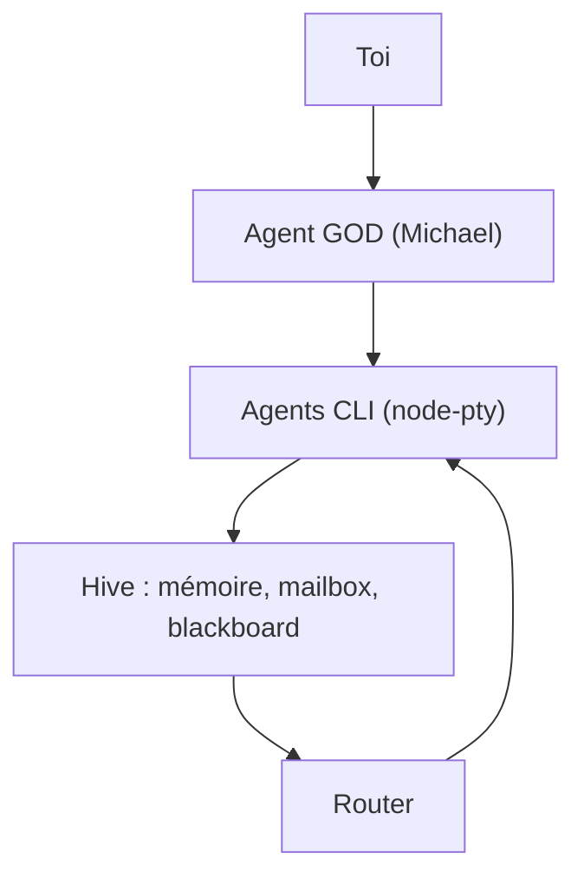

# chaitanyagiri/munder-difflin

> Application de bureau qui orchestre plusieurs CLI d'agents de code comme une équipe, avec mémoire partagée.

## Le problème
Faire travailler plusieurs agents en terminal (Claude Code, Codex, Gemini...) demande de les coordonner à la main.

## Ce que ça fait vraiment
App Electron qui lance chaque CLI d'agent dans un `node-pty`, avec mémoire en markdown, boîtes aux lettres par fichiers et un agent orchestrateur (« GOD », Michael) qui route les tâches et n'escalade que les dépenses ou opérations destructrices. Des avatars Pixi.js représentent les sessions. Une offre Pro payante ajoute Capabilities, Stapler (dictée, réunions) et une barre latérale.

## Comment c'est branché


## Essayer
```bash
git clone https://github.com/chaitanyagiri/munder-difflin.git
cd munder-difflin
npm install
npm run dev
```

## Coût et pièges
Il faut au moins une CLI d'agent installée avec son abonnement ou sa clé. Pro : 150 USD par an après le 24 octobre 2026 (gratuit avant). Les builds officiels envoient des événements d'usage anonymes ; opt-out possible.

## Ce que ce n'est pas
Pas un framework d'agents programmable : c'est une application de bureau. Le chiffre de -37 % de tokens vient d'une rejeu, pas d'une mesure en conditions réelles.

## Alternatives
Aucune alternative nommée dans le README.

## Pour toi
Surveiller : utile pour piloter plusieurs agents de code, mais projet jeune, modèle freemium et télémétrie dans les builds officiels.

