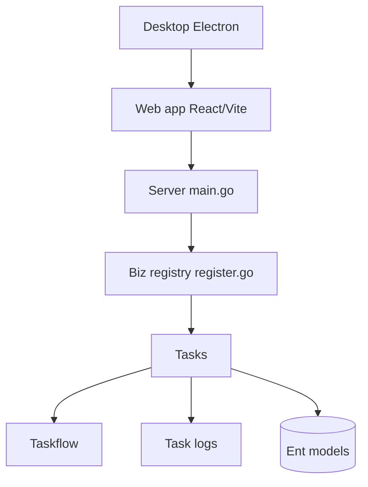

# chaitin/MonkeyCode

> Self-hostable team platform where an AI handles office work, code and design, with centralized management.

## The problem
A team that wants shared AI assistants has no access control, no usage tracking, and no data kept in-house.

## What it actually does
A Go server (backend/cmd/server/main.go) exposes tasks, projects, teams and a Git gateway (GitHub, GitLab, Gitea, Gitee). Each task runs on managed virtual machines, with logs in ClickHouse or Loki. A React/Vite interface serves as the web client, wrapped by Electron and Capacitor. An admin panel manages models, MCP, permissions, audit and billing. README in Chinese.

## How it is wired


## Trying it
```bash
bash -c "$(curl -kfsSL https://release.monkeycode-ai.com/public/monkeyai-install.sh)"
```
The README states a minimum of 1 core and 1 GB of RAM, and an online demo.

## Cost and gotchas
The models are the ones you configure: content is sent to them. The free version is limited to 10 seats, the rest is paid on quote. The install script uses `curl -k` (certificate not verified).

## What it is not
Not a standalone code assistant: it is a team platform with a server. Not a local AI tool: operation depends on external models. The "cloud" scope assumes virtual machine hosts.

## Alternatives
No alternative named in the README.

## For you
Worth watching: useful if your team wants a self-hosted AI hub, but the documentation is in Chinese and the AGPL license must be validated before any wider internal use.
