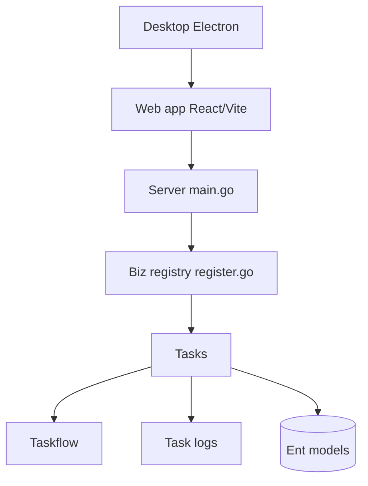

# chaitin/MonkeyCode

> Plateforme d'équipe auto-hébergeable où une IA fait du bureau, du code et du design, avec gestion centralisée.

## Le problème
Une équipe qui veut des assistants IA partagés n'a ni contrôle des accès, ni suivi de consommation, ni données chez elle.

## Ce que ça fait vraiment
Un serveur Go (backend/cmd/server/main.go) expose tâches, projets, équipes et passerelle Git (GitHub, GitLab, Gitea, Gitee). Chaque tâche s'exécute sur des machines virtuelles gérées, avec journaux dans ClickHouse ou Loki. Une interface React/Vite sert de client web, enveloppée par Electron et Capacitor. Un panneau d'administration gère modèles, MCP, droits, audit et facturation. README en chinois.

## Comment c'est branché


## Essayer
```bash
bash -c "$(curl -kfsSL https://release.monkeycode-ai.com/public/monkeyai-install.sh)"
```
Le README annonce 1 cœur et 1 Go de RAM au minimum, et une démo en ligne.

## Coût et pièges
Les modèles sont ceux que tu configures : les contenus partent vers eux. Version gratuite limitée à 10 sièges, le reste est payant sur devis. Le script d'installation utilise `curl -k` (certificat non vérifié).

## Ce que ce n'est pas
Pas un assistant de code isolé : c'est une plateforme d'équipe avec serveur. Pas un outil d'IA locale : le fonctionnement dépend de modèles externes. Le périmètre « cloud » suppose des hôtes de machines virtuelles.

## Alternatives
Aucune alternative nommée dans le README.

## Pour toi
À surveiller : utile si ton équipe veut un hub IA auto-hébergé, mais documentation en chinois et licence AGPL à valider avant tout usage interne étendu.

