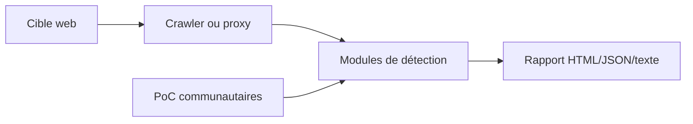

# chaitin/xray

> Chaitin's web vulnerability scanner, a closed-source binary, for authorized security auditors.

## The problem
Auditing a web application by hand, module by module, is slow. An automated scanner covers the common classes of flaws.

## What it actually does
The binary is not open source: the repository mostly contains community PoCs, repackaged with each release. The tool analyzes a site (crawler, passive proxy or single URL) with modules: XSS, SQL injection, path traversal, SSRF, header checks, etc. Some modules (Struts2, ThinkPHP, Shiro, fastjson) are reserved for the advanced edition. Results are output as HTML, text or JSON.

## How it is wired


## Trying it
```bash
xray webscan --basic-crawler http://example.com --html-output vuln.html
xray webscan --listen 127.0.0.1:7777 --html-output proxy.html
xray webscan --url http://example.com/?a=b --html-output single-url.html
```
Only use it on targets for which you have written authorization.

## Cost and gotchas
Free in the community edition, advanced modules are paid. The license file must be accepted before use. Docs and community mostly in Chinese.

## What it is not
Not an open source project: you cannot audit the scanner's code. Not a tool to run on third-party systems without consent. The README says nothing about telemetry.

## Alternatives
- chaitin/xpoc: same publisher, supply-chain vulnerability scanning.
- chaitin/xapp: same publisher, web technology identification.

## For you
Keep an eye on it: useful only if you do authorized web audits, and the closed binary (unidentified license, last push two years ago) matters little for a data/AI/MLOps profile.
