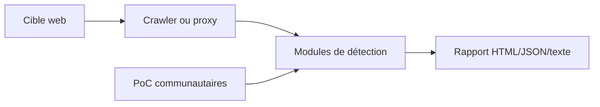

# chaitin/xray

> Scanner de vulnérabilités web de Chaitin, en binaire fermé, pour auditeurs sécurité autorisés.

## Le problème
Auditer une application web à la main, module par module, est long. Un scanner automatisé couvre les classes de failles courantes.

## Ce que ça fait vraiment
Le binaire n'est pas open source : le dépôt contient surtout des PoC communautaires, repackagés à chaque release. L'outil analyse un site (crawler, proxy passif ou URL unique) avec des modules : XSS, injection SQL, traversée de chemin, SSRF, contrôle d'en-têtes, etc. Certains modules (Struts2, ThinkPHP, Shiro, fastjson) sont réservés à l'édition avancée. Les résultats sortent en HTML, texte ou JSON.

## Comment c'est branché


## Essayer
```bash
xray webscan --basic-crawler http://example.com --html-output vuln.html
xray webscan --listen 127.0.0.1:7777 --html-output proxy.html
xray webscan --url http://example.com/?a=b --html-output single-url.html
```
À n'utiliser que sur des cibles dont on a l'autorisation écrite.

## Coût et pièges
Gratuit en édition communautaire, modules avancés payants. Le fichier de licence doit être accepté avant usage. Docs et communauté surtout en chinois.

## Ce que ce n'est pas
Pas un projet open source : on ne peut pas auditer le code du scanner. Ce n'est pas un outil à lancer sur des systèmes tiers sans accord. Le README ne dit rien de la télémétrie.

## Alternatives
- chaitin/xpoc : même éditeur, scan de vulnérabilités de chaîne d'approvisionnement.
- chaitin/xapp : même éditeur, identification de technologies web.

## Pour toi
À surveiller : utile seulement si tu fais des audits web autorisés, et la fermeture du binaire (licence non identifiée, dernier push d'il y a deux ans) pèse peu pour un profil data/IA/MLOps.

