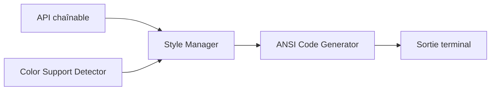

# chalk/chalk

> Node.js library for styling strings in the terminal (colors, bold, underline).

## The problem
Writing ANSI codes by hand is unreadable and does not handle terminals without color support.

## What it actually does
Chainable API (`chalk.blue.bgRed.bold('…')`) with style nesting, 16, 256 and true colors (RGB, hex), automatic support detection (levels 0 to 3) and custom themes. No dependencies, does not extend `String.prototype`. Chalk 5 is ESM only: the README recommends Chalk 4 for TypeScript or certain build tools.

## How it is wired


## Trying it
```bash
npm install chalk
```
```js
import chalk from 'chalk';
console.log(chalk.blue('Hello world!'));
```

## Cost and gotchas
Free. ESM only since Chalk 5. Changing `chalk.level` is global.

## What it is not
Not a terminal UI framework, only coloring.

## Alternatives
- yoctocolors: smaller, by the same author, cited by the README.

## For you
Watch: relevant only if you write tools in Node; in Python, the equivalent is a different library.
