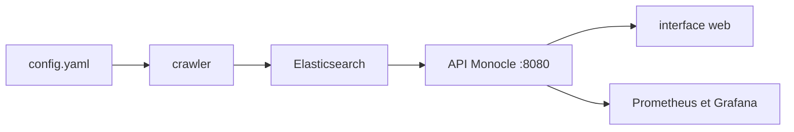

# change-metrics/monocle

> Code change analysis tool (GitHub, GitLab, Gerrit) for development teams.

## The problem
It is hard to see how changes are produced and reviewed within a team, and to spot review anomalies.

## What it actually does
Crawlers fetch pull requests, merge requests and Gerrit reviews, as well as GitHub issues and Bugzilla bugs. They feed Elasticsearch. An API and a web interface display dashboards and metrics, with projects, identities, groups and OIDC authentication. An `api/2/metric/get` endpoint exposes the metrics.

## How it is wired
Simplified diagram based on the sheet, no diagram provided.



## Trying it
```bash
git clone https://github.com/change-metrics/monocle.git
cd monocle
echo CRAWLERS_API_KEY=$(uuidgen) > .secrets
docker-compose up -d
docker-compose ps
```

## Cost and gotchas
Docker and Elasticsearch (512 MB JVM heap by default). A GitHub or GitLab token is needed to explore repositories. AGPL-3.0 license: strong copyleft for use as a service. More than 120 open issues.

## What it is not
Not a code review tool: it measures, it does not review. Individual activity metrics can be misused to evaluate people.

## Alternatives
No alternative named in the README.

## For you
Watch: relevant for an MLOps engineer who wants review and change-flow metrics; the Elasticsearch infrastructure is heavy for one-off use.
