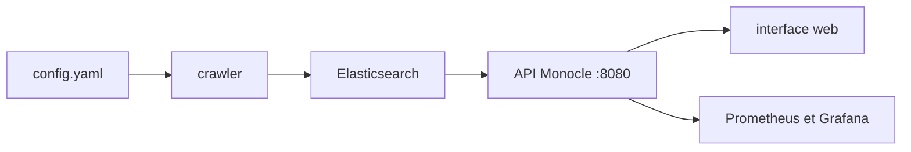

# change-metrics/monocle

> Outil d'analyse des changements de code (GitHub, GitLab, Gerrit) pour équipes de développement.

## Le problème
Difficile de voir comment les changements sont produits et relus dans une équipe, et de repérer les anomalies de revue.

## Ce que ça fait vraiment
Des crawlers récupèrent pull requests, merge requests et revues Gerrit, ainsi que des tickets GitHub et des bugs Bugzilla. Ils alimentent Elasticsearch. Une API et une interface web affichent tableaux de bord et métriques, avec projets, identités, groupes et authentification OIDC. Un point d'accès `api/2/metric/get` expose les métriques.

## Comment c'est branché
Schéma simplifié d'après la fiche, sans diagramme fourni.



## Essayer
```bash
git clone https://github.com/change-metrics/monocle.git
cd monocle
echo CRAWLERS_API_KEY=$(uuidgen) > .secrets
docker-compose up -d
docker-compose ps
```

## Coût et pièges
Docker et Elasticsearch (tas JVM de 512 Mo par défaut). Jeton GitHub ou GitLab pour explorer les dépôts. Licence AGPL-3.0 : copyleft fort pour un usage en service. Plus de 120 issues ouvertes.

## Ce que ce n'est pas
Pas un outil de revue de code : il mesure, il ne relit pas. Les métriques d'activité individuelles peuvent être mal utilisées pour évaluer des personnes.

## Alternatives
Aucune alternative nommée dans le README.

## Pour toi
Surveiller : pertinent pour un MLOps qui veut des métriques de revue et de flux de changements ; l'infrastructure Elasticsearch pèse pour un usage ponctuel.

