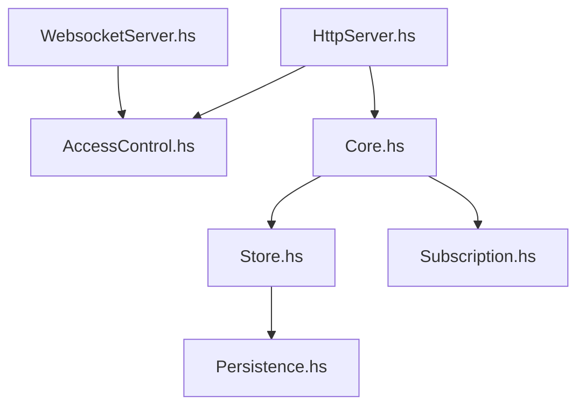

# channable/icepeak

> JSON document store with an HTTP API, WebSocket push notifications and JWT authorization.

## The problem
You need to store JSON and notify clients as soon as part of it changes, without polling in a loop.

## What it actually does
Clients read and write over HTTP, or subscribe over WebSocket to a path such as `/users/123/status` and receive changes. Read/write permissions by prefix come from a JWT claim. Data is persisted in a JSON file, with Prometheus metrics. Used in production at Channable since 2017, but considered "beta".

## How it is wired
Diagram based on the code.



## Trying it
```bash
cabal test -j icepeak
cabal run -j icepeak
icepeak --data-file icepeak.json --enable-jwt-auth
```

## Cost and gotchas
Free. You must build it with Cabal (GHC, or Nix). Without a JWT secret, token signatures are not verified. Designed for non-critical data and a small database.

## What it is not
Not a general-purpose database: a single JSON document, suited to small volumes.

## Alternatives
None mentioned in the README.

## For you
Watch: useful for a small real-time shared state, but it is Haskell and self-described as beta; prefer an established database for anything critical.
