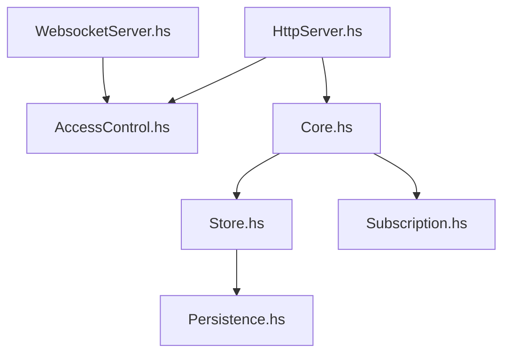

# channable/icepeak

> Magasin de documents JSON avec API HTTP, WebSocket de notifications push et autorisation JWT.

## Le problème
Il faut stocker du JSON et prévenir les clients dès qu'une partie change, sans interroger en boucle.

## Ce que ça fait vraiment
Les clients lisent et écrivent par HTTP, ou s'abonnent par WebSocket à un chemin comme `/users/123/status` et reçoivent les changements. Les droits lecture/écriture par préfixe viennent d'une revendication JWT. Les données sont persistées dans un fichier JSON, avec des métriques Prometheus. Servi en production chez Channable depuis 2017, mais jugé « bêta ».

## Comment c'est branché
Schéma d'après le diagramme du code.



## Essayer
```bash
cabal test -j icepeak
cabal run -j icepeak
icepeak --data-file icepeak.json --enable-jwt-auth
```

## Coût et pièges
Gratuit. Il faut compiler avec Cabal (GHC, ou Nix). Sans secret JWT, la signature des jetons n'est pas vérifiée. Pensé pour des données non critiques et une petite base.

## Ce que ce n'est pas
Pas une base de données générale : un seul document JSON, adapté aux petits volumes.

## Alternatives
Aucune citée dans le README.

## Pour toi
Surveiller : utile pour un petit état partagé temps réel, mais Haskell et auto-qualifié bêta ; il vaut mieux une base établie pour du critique.

