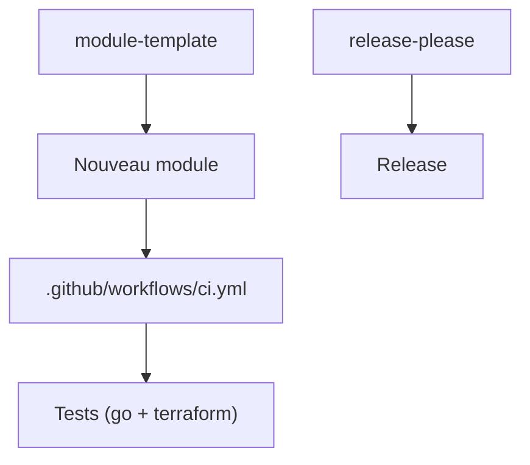

# chanzuckerberg/cztack

> Collection of Terraform modules from the Chan Zuckerberg Initiative to scale its infrastructure.

## The problem
Rewriting the same Terraform building blocks from one project to the next wastes time and creates drift.

## What it actually does
The README is mostly a contribution guide: how to publish a release, add a module and write tests. Releases are managed by release-please. It does not list the modules provided. Tests require Go, Terraform and the bless provider.

## How it is wired
Simplified diagram based on the sheet, no diagram provided.

## Trying it
No command documented in the README provided.

## Cost and gotchas
Tests run on AWS: IAM is eventually consistent, so it is better to target us-east-1. Do not run the tests in parallel, and clean up state files before and after.

## What it is not
It is not a documented catalog: the list of modules does not appear in the README. It is stated to be compatible with Terraform 0.12 and above, which is dated.

## Alternatives
- No alternative named in the README.

## For you
Ignore: the README does not present what the modules offer, and it mainly serves CZI's teams.
