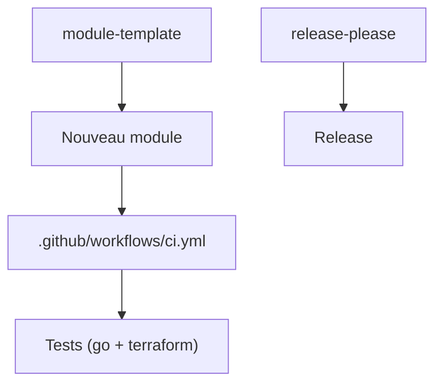

# chanzuckerberg/cztack

> Collection de modules Terraform de la Chan Zuckerberg Initiative pour passer à l'échelle son infrastructure.

## Le problème
Réécrire les mêmes briques Terraform d'un projet à l'autre fait perdre du temps et crée des écarts.

## Ce que ça fait vraiment
Le README est surtout un guide de contribution : comment publier une version, ajouter un module et écrire des tests. Les releases sont gérées par release-please. Il ne liste pas les modules fournis. Les tests demandent Go, Terraform et le provider bless.

## Comment c'est branché
Schéma simplifié d'après la fiche, sans diagramme fourni.

## Essayer
Aucune commande documentée dans le README fourni.

## Coût et pièges
Les tests s'exécutent sur AWS : l'IAM est à cohérence éventuelle, il vaut mieux viser us-east-1. Il faut ne pas lancer les tests en parallèle et nettoyer les fichiers d'état avant et après.

## Ce que ce n'est pas
Ce n'est pas un catalogue documenté : la liste des modules n'apparaît pas dans le README. Il est annoncé compatible Terraform 0.12 et plus, ce qui date.

## Alternatives
- Aucune alternative nommée dans le README.

## Pour toi
À ignorer : le README ne présente pas ce que les modules offrent, et il sert surtout aux équipes de CZI.

