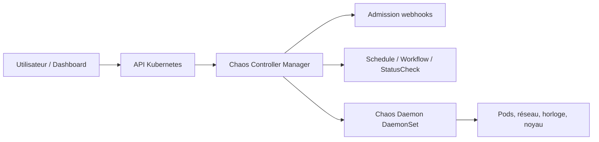

# chaos-mesh/chaos-mesh

> Chaos engineering platform for Kubernetes, driven by custom resources.

## The problem
You do not know whether a system survives failure until you have caused it, and injecting a network or clock fault without breaking the neighbours on the same node is delicate.

## What it actually does
Chaos experiments are CRDs: they are defined, orchestrated and observed through the standard Kubernetes API, with the usual RBAC. Broad fault coverage — pod, network, DNS, HTTP, I/O, time, stress, kernel, block device, JVM, physical machine, AWS, Azure, GCP. The `Schedule`, `Workflow` and `StatusCheck` resources allow recurring experiments, serial or parallel chaining and application health checks. Multi-cluster execution from a management cluster.

## How it is wired


## Trying it
```bash
# Aucune commande documentée dans le README : il renvoie à l'installation par Helm,
# au guide « Run a Chaos experiment » et au playground Killercoda en navigateur.
```

## Cost and gotchas
Free, CNCF incubating project, trademark held by the Linux Foundation. The Chaos Daemon runs as a DaemonSet and performs **privileged** operations at node and container level: this is an attack surface to scope. The Dashboard is optional if everything goes through the API.

## What it is not
It is not a load-testing or monitoring tool. It cannot be used outside Kubernetes, except for "physical machine" faults. Deliberately breaking production without a recovery plan remains a bad idea that the tool does not protect against.

## Alternatives
No alternative named in the README.

## For you
Relevant only if you run a production cluster; out of scope for pure data work.
