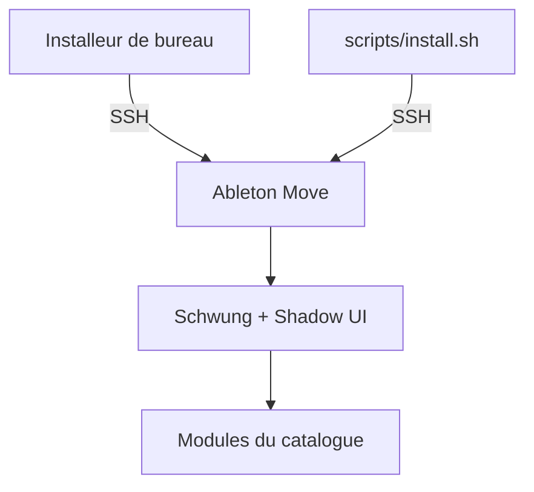

# charlesvestal/move-everything

> Unofficial framework (Schwung) for running homemade synths, effects and controllers on the Ableton Move.

## The problem
The Ableton Move is closed: you cannot add your own instruments or effects to it.

## What it actually does
Adds a "Shadow UI" that runs alongside the original interface, with a catalog of installable modules. Installation goes through SSH to the device, via a desktop installer or an `install.sh` script; an uninstall script exports the backups first.

## How it is wired


## Trying it
```bash
curl -L https://raw.githubusercontent.com/charlesvestal/schwung/main/scripts/install.sh | sh
curl -L https://raw.githubusercontent.com/charlesvestal/schwung/main/scripts/uninstall.sh | sh
```

## Cost and gotchas
Free, but you need a Move connected to Wi-Fi and SSH access. The project modifies the device's software: backup and DFU restore mode recommended. The README says it is unstable and largely written by AI agents.

## What it is not
Not an Ableton-supported product nor an everyday tool, according to the author.

## Alternatives
No alternative named in the README.

## For you
Ignore: music tinkering on dedicated hardware, unrelated to data, AI or MLOps.
