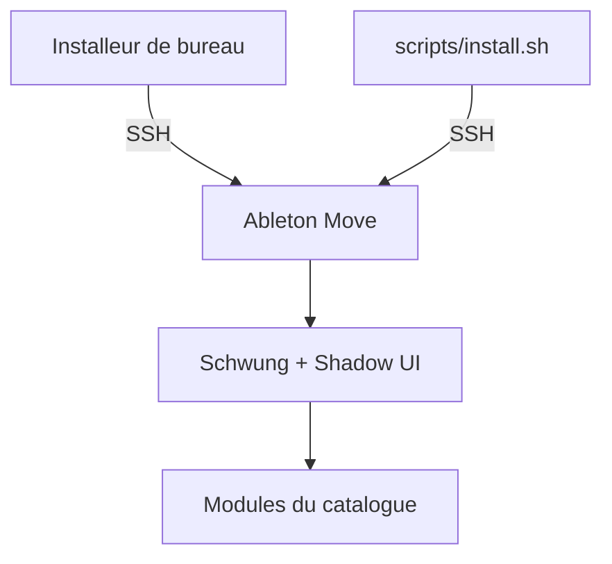

# charlesvestal/move-everything

> Framework non officiel (Schwung) pour faire tourner synthés, effets et contrôleurs maison sur l'Ableton Move.

## Le problème
L'Ableton Move est fermé : on ne peut pas y ajouter ses propres instruments ou effets.

## Ce que ça fait vraiment
Ajoute une « Shadow UI » qui tourne en parallèle de l'interface d'origine, avec un catalogue de modules installables. L'installation passe par SSH sur l'appareil, via un installeur de bureau ou un script `install.sh` ; un script de désinstallation exporte d'abord les sauvegardes.

## Comment c'est branché


## Essayer
```bash
curl -L https://raw.githubusercontent.com/charlesvestal/schwung/main/scripts/install.sh | sh
curl -L https://raw.githubusercontent.com/charlesvestal/schwung/main/scripts/uninstall.sh | sh
```

## Coût et pièges
Gratuit, mais il faut un Move connecté au Wi-Fi et un accès SSH. Le projet modifie le logiciel de l'appareil : sauvegarde et mode de restauration DFU recommandés. Le README le dit instable et en grande partie écrit par des agents IA.

## Ce que ce n'est pas
Pas un produit soutenu par Ableton ni un outil du quotidien, selon l'auteur.

## Alternatives
Aucune alternative nommée dans le README.

## Pour toi
À ignorer : bidouille de musique sur matériel dédié, sans lien avec la data, l'IA ou le MLOps.

