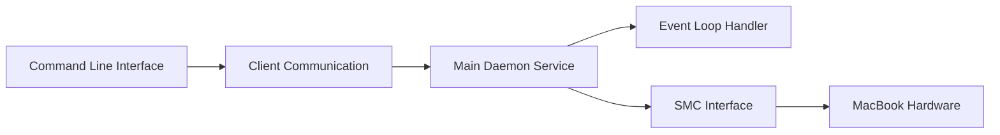

# charlie0129/batt

> Tool to limit the charge of Apple Silicon MacBook batteries, from the command line or a menu.

## The problem
Keeping a MacBook at 100% while plugged in wears the battery; the system "optimized charging" option follows an unpredictable schedule.

## What it actually does
A daemon (Go, with C for IOKit and the SMC) controls charging; a CLI client or a menu bar application talks to it over a Unix socket. It sets a cap (60% by default), cuts the adapter, drives the MagSafe LED, calibrates the battery. The README notes that macOS 26.4+ can limit charging natively (80-100%): `batt` remains useful below 80%. Requires root privileges, no telemetry according to the author.

## How it is wired


## Trying it
```bash
brew install batt
sudo brew services start batt
sudo batt status
sudo batt limit 80
```

## Cost and gotchas
Free; root required (SMC write). Apple Silicon only. Compatibility is tied to the firmware, not the macOS version; the macOS 27 betas are partially unsupported.

## What it is not
Not a tool for Intel Macs. Does not work while the Mac is powered off.

## Alternatives
No alternative named in the README (BattGUI and batt-helper are interfaces built around `batt`).

## For you
Ignore: a personal laptop utility unrelated to data or AI, unless you want to protect your battery.
