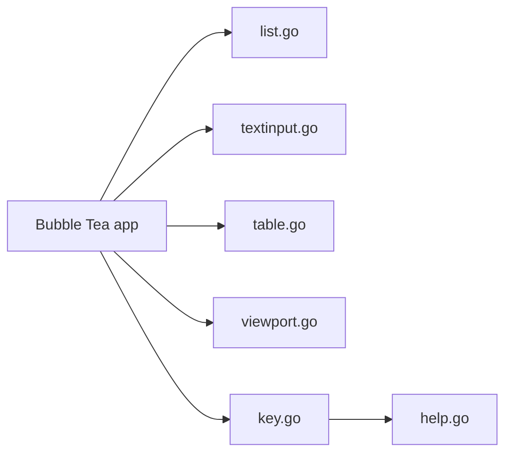

# charmbracelet/bubbles

> Terminal UI components in Go, to be used with Bubble Tea.

## The problem
Building terminal interfaces (input, lists, tables) from scratch is slow.

## What it actually does
Ready-to-plug components: spinner, text input, text area, table, progress bar, pagination, viewport, list (fuzzy filtering, automatic help), file picker, timer, stopwatch, help, key binding management (`key`). Used in Crush. The code also shows a tree component.

## How it is wired


## Trying it
The README gives no installation command; it shows a key handling example:
```go
key.NewBinding(key.WithKeys("k", "up"), key.WithHelp("↑/k", "move up"))
```

## Cost and gotchas
Free. A migration guide from v1 is mentioned. 235 open issues.

## What it is not
Not a standalone framework: without Bubble Tea, nothing runs. No installation command in the README.

## Alternatives
None named (community components: charm-and-friends/additional-bubbles).

## For you
Worth watching: useful if you write interactive Go CLIs for your MLOps tools; irrelevant in Python.
