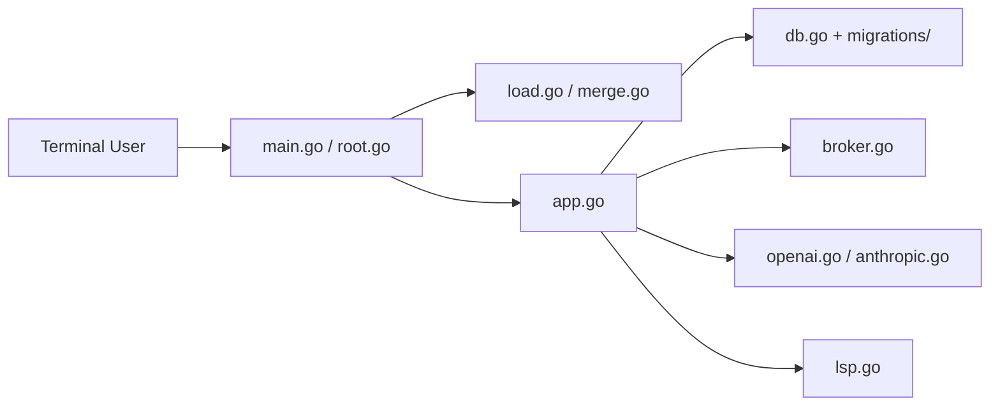

# charmbracelet/crush

> Terminal coding agent (Go), multi-provider LLM, with LSP, MCP and skills.

## The problem
Terminal coding agents are often tied to a single provider; switching models mid-session or plugging in a local model is laborious.

## What it actually does
Go TUI: multiple sessions per project, model switching mid-session, context enriched by LSP.
Providers: Anthropic, OpenAI, Gemini, Bedrock, Vertex, OpenRouter, Ollama, llama.cpp… (Catwalk catalog).
Config in `crushrc` (interpreted Bash), MCP stdio/http/sse with OAuth, Agent Skills, hooks, tool permissions.
State in SQLite, logs in `.crush/logs`, shared server mode (`crush serve`).

## How it is wired


## Trying it
```bash
brew install charmbracelet/tap/crush
npm install -g @charmland/crush
go install github.com/charmbracelet/crush@latest
crush logs --follow
```

## Cost and gotchas
API key at your expense (or a local model), or a Hyper subscription. `crushrc` runs shell: do not launch it in a folder you have not reviewed. Pseudonymous metrics enabled by default (`CRUSH_DISABLE_METRICS=1`).

## What it is not
Not an IDE. Bedrock without cache. The `--yolo` mode removes all confirmation.

## Alternatives
No alternative named in the README.

## For you
Keep an eye on it: interesting for testing local models (Ollama) in a terminal agent, but your Claude Code workflow already covers most of it; telemetry and license to check.
