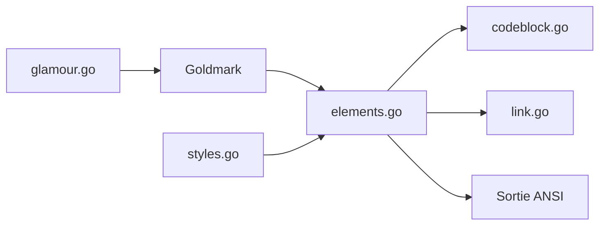

# charmbracelet/glamour

> ANSI-styled Markdown rendering in the terminal for Go applications, with stylesheets.

## The problem
Displaying readable Markdown in a terminal requires handling colors, line wrapping and code blocks.

## What it actually does
Parses Markdown with Goldmark, maps each node to an ANSI element, applies a built-in or file-based style. Syntax highlighting of code blocks, links and table footnote links, emoji. The rendering is "pure": no color downsampling, to be done with Lip Gloss.

## How it is wired


## Trying it
```go
import "charm.land/glamour/v2"

out, err := glamour.Render(in, "dark")
fmt.Print(out)
```

## Cost and gotchas
Free. The `GLAMOUR_STYLE` variable forces a style. 161 open issues.

## What it is not
Not a viewer in itself: for that, the README points to Glow.

## Alternatives
Glow (command-line rendering tool) built on glamour.

## For you
Useful for a Go agent or MLOps CLI that displays Markdown responses; otherwise irrelevant: adopt in that case.
