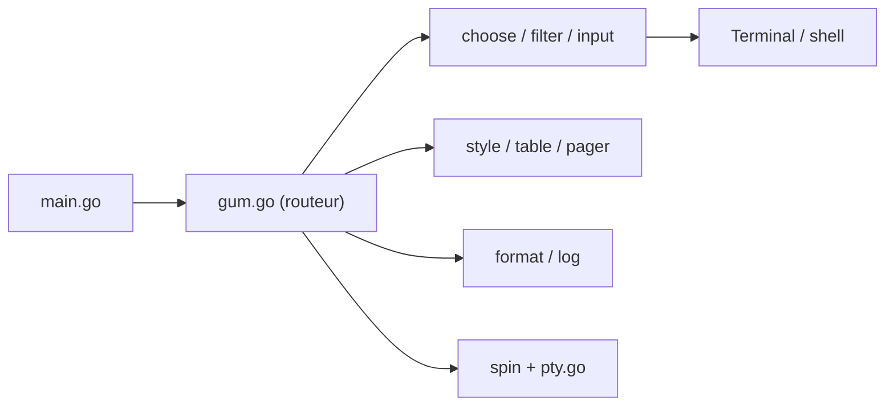

# charmbracelet/gum

> Go binary that adds menus, prompts and formatting to shell scripts, without writing Go.

## The problem
Interactive shell scripts are ugly and painful: `read`, `select` and ANSI codes by hand.

## What it actually does
Composable subcommands: `choose`, `confirm`, `file`, `filter` (fuzzy), `format`, `input`, `join`, `pager`, `spin`, `style`, `table`, `write`, `log`. They read stdin or arguments, display an interface in the terminal and write the result to stdout, with an exit code for `confirm`. Options via flags or `GUM_*` environment variables.

## How it is wired


## Trying it
```bash
brew install gum
gum choose "fix" "feat" "docs"
gum confirm "Commit changes?" && git commit -m "$SUMMARY"
gum spin --spinner dot --title "Buying Bubble Gum..." -- sleep 5
```

## Cost and gotchas
Free, no key. The package installs through a package manager, a binary or `go install`.

## What it is not
Not a TUI library: it is for scripts, not for building a full interactive application.

## Alternatives
No alternative named in the README (it builds on Bubbles and Lip Gloss).

## For you
Adopt: makes your orchestration scripts (choice of repo, branch, model, confirmation) safer in a few lines.
