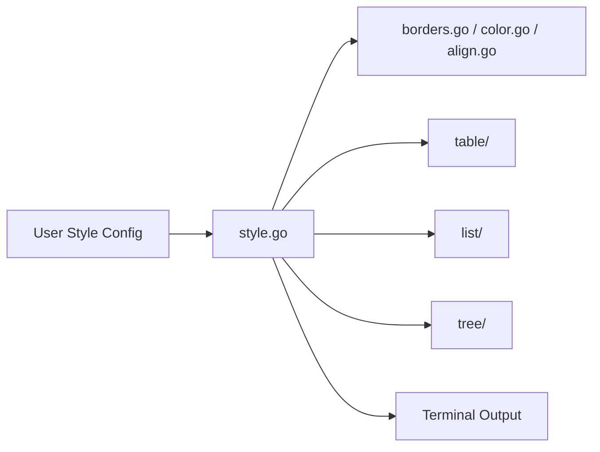

# charmbracelet/lipgloss

> Go library for declarative, CSS-like styling of terminal interfaces.

## The problem
Assembling terminal views (colors, margins, borders, alignment) by hand is tedious.

## What it actually does
A chained `NewStyle()` API handles colors (ANSI 16, 256, TrueColor with automatic downsampling), borders, margins, alignment, width/height. Utilities assemble blocks (`JoinHorizontal`, `Place`, layer compositor), and sub-packages render tables, lists and trees.

## How it is wired


## Trying it
```bash
go get charm.land/lipgloss/v2
```

## Cost and gotchas
Free. Migration from v1: dedicated guide, `compat` package for adaptive colors.

## What it is not
Not an application framework: it works alongside Bubble Tea without replacing it, and it is not a Markdown engine (see Glamour).

## Alternatives
Glamour, cited by the README, for document-centered Markdown rendering.

## For you
Worth watching: useful only if you write Go tools with a polished terminal interface.
