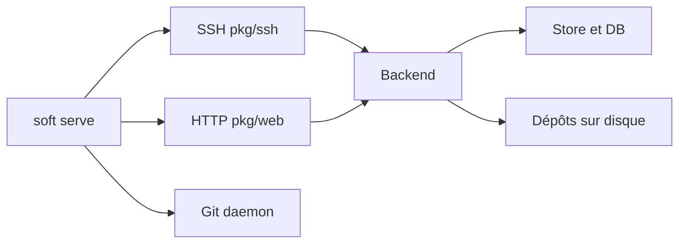

# charmbracelet/soft-serve

> Self-hosted Git server as a single binary, driven over SSH with a terminal interface.

## The problem
Hosting a few private Git repositories without installing a heavy forge.

## What it is not like a forge: it serves repositories over SSH, HTTP and the git protocol, with a TUI accessible via `ssh`.

## What it actually does
A `soft` binary serves repositories over SSH, HTTP(S) and git://, and manages users, public keys, access tokens, collaborators, webhooks, server hooks, mirrors and Git LFS. Metadata in SQLite or PostgreSQL, repositories on disk. Administration is done entirely through SSH commands.

## How it is wired


## Trying it
```bash
brew install charmbracelet/tap/soft-serve
SOFT_SERVE_INITIAL_ADMIN_KEYS="$(cat ~/.ssh/id_ed25519.pub)" soft serve
ssh -p 23231 localhost repo create icecream
```

## Cost and gotchas
Free. By default anonymous access is read-only; the variable `SOFT_SERVE_ANON_ACCESS=admin-access` gives admin access without authentication (local use only). Recent RSA keys (SHA-2) are not supported; prefer Ed25519.

## What it is not
Not a full forge: no pull requests or built-in CI, only hooks and webhooks.

## Alternatives
No alternative named in the README.

## For you
Worth watching: handy for a lightweight Git remote (dotfiles, lab GitOps), but without code review or CI it does not replace a team forge.
