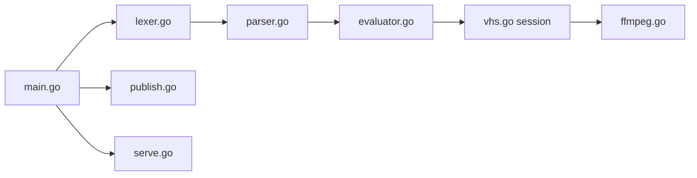

# charmbracelet/vhs

> Describes a terminal session in a script file and generates a GIF or video from it.

## The problem
CLI demos recorded by hand take a long time to redo and go stale with every change.

## What it actually does
A `.tape` file lists commands (Output, Set, Type, Sleep, Wait, Hide/Show, Screenshot…). VHS reads it, plays the session in a virtual terminal (ttyd + browser), captures the frames, and ffmpeg produces GIF, MP4, WebM or PNG. It can also record your actions into a tape, publish to vhs.charm.sh, serve over SSH, and write golden files (.txt/.ascii) for integration tests.

## How it is wired


## Trying it
```bash
brew install vhs
vhs new demo.tape
vhs demo.tape
docker run --rm -v $PWD:/vhs ghcr.io/charmbracelet/vhs <cassette>.tape
```

## Cost and gotchas
Free. Requires ttyd and ffmpeg in the PATH (included in the Docker image). `vhs publish` uploads the GIF to Charm's servers; the SSH server is open to everyone if no authorized key is configured.

## What it is not
Not a general screen recorder: it replays a script, it does not film.

## Alternatives
No alternative named in the README.

## For you
Very good for cleanly illustrating a CLI tool's README or a tutorial; reproducible in CI, so worth adopting.
