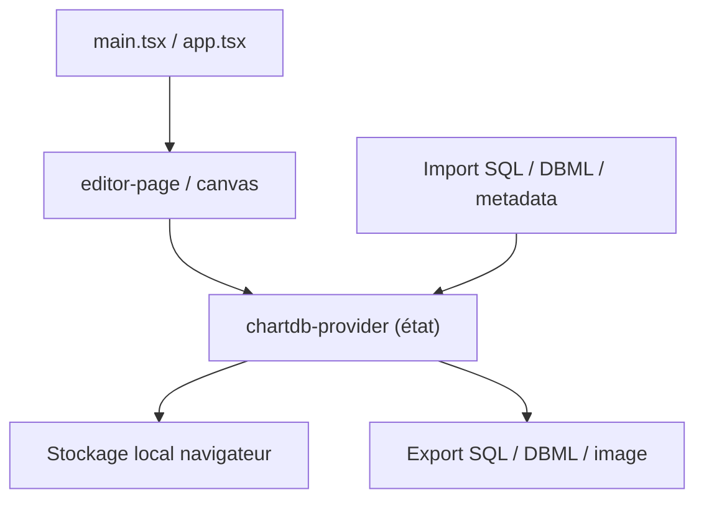

# chartdb/chartdb

> Web editor for database diagrams: imports a schema, visualizes it, exports SQL.

## The problem
Documenting and understanding an existing database schema without giving a tool any access or password.

## What it actually does
You run a provided query, paste the resulting JSON, and the editor draws the schema. Import from SQL, DBML or metadata (PostgreSQL, MySQL, SQL Server, SQLite, Oracle, CockroachDB, ClickHouse). Export to SQL, DBML, images, with conversion between dialects; AI-assisted export calls an OpenAI-compatible endpoint. According to the code, everything stays in the browser, with no backend.

## How it is wired


## Trying it
```bash
npm install
npm run dev
docker run -e OPENAI_API_KEY=<YOUR_OPEN_AI_KEY> -p 8080:80 ghcr.io/chartdb/chartdb:latest
```

## Cost and gotchas
Free. AI export requires an OpenAI key or a compatible server (for example vLLM) at your expense. Fathom Analytics is on by default; `DISABLE_ANALYTICS=true` turns it off.

## What it is not
Does not connect to your database: you only hand over the result of a query. Public Beta, no stability guarantee. AGPL-3.0 license.

## Alternatives
No named alternative in the README.

## For you
Adopt: a quick tool to map a data warehouse or a feature schema without direct access; turn off telemetry when self-hosting.
