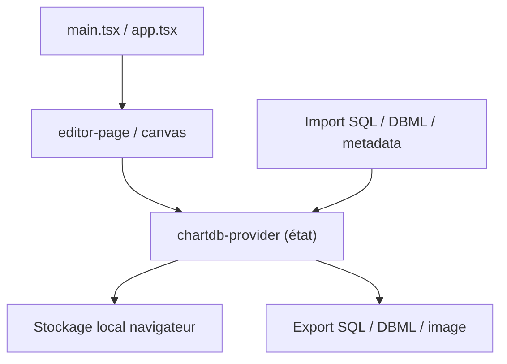

# chartdb/chartdb

> Éditeur web de diagrammes de bases de données : importe un schéma, le visualise, exporte du SQL.

## Le problème
Documenter et comprendre un schéma de base existant sans donner d'accès ni de mot de passe à un outil.

## Ce que ça fait vraiment
Tu exécutes une requête fournie, tu colles le JSON obtenu, et l'éditeur dessine le schéma. Import SQL, DBML ou métadonnées (PostgreSQL, MySQL, SQL Server, SQLite, Oracle, CockroachDB, ClickHouse). Export SQL, DBML, images, avec conversion entre dialectes ; l'export assisté par IA appelle un endpoint compatible OpenAI. D'après le code, tout reste côté navigateur, sans backend.

## Comment c'est branché


## Essayer
```bash
npm install
npm run dev
docker run -e OPENAI_API_KEY=<YOUR_OPEN_AI_KEY> -p 8080:80 ghcr.io/chartdb/chartdb:latest
```

## Coût et pièges
Gratuit. L'export IA demande une clé OpenAI ou un serveur compatible (par exemple vLLM) à ta charge. Fathom Analytics actif par défaut ; `DISABLE_ANALYTICS=true` le coupe.

## Ce que ce n'est pas
Ne se connecte pas à ta base : tu transmets seulement le résultat d'une requête. Public Beta, pas de garantie de stabilité. Licence AGPL-3.0.

## Alternatives
Aucune alternative nommée dans le README.

## Pour toi
À adopter : outil rapide pour cartographier un entrepôt de données ou un schéma de features sans accès direct ; couper la télémétrie en auto-hébergement.

