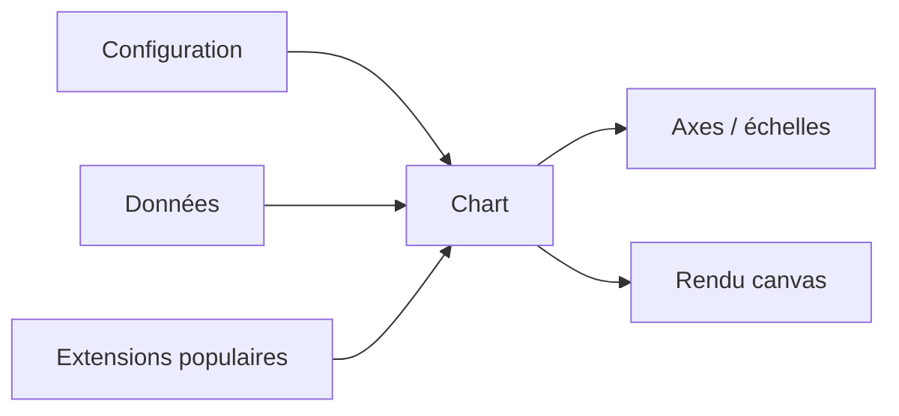

# chartjs/Chart.js

> JavaScript library for creating charts, for developers and designers.

## The problem
Creating a graph in JavaScript without a library means handling the canvas, axes, and scales manually.

## What it actually does
The provided README only contains a brief description and a table of contents for the documentation (Introduction, Getting Started, Configuration, Charts, Axes, Developers, Extensions, Samples). Current version: 4. Documentation for older versions is still accessible by specifying the version in the URL.

## How it is wired

## Trying it
No installation instructions are documented in the provided README.

## Cost and gotchas
Free. No other information is provided: no license, no dependencies, no prerequisites.

## What it is not
The README is too short to provide a clear understanding of the actual coverage: it does not include a list of supported chart types, browser compatibility information, or a performance model for large datasets.

## Alternatives
No alternative is specified in the README file.

## For you
Minimum requirements: insufficient information. Please refer to the official documentation before making a decision.
