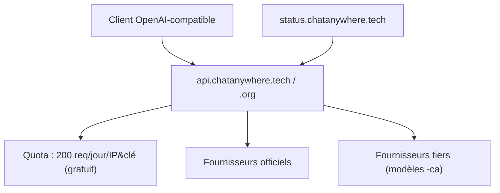

# chatanywhere/GPT_API_free

> Chinese gateway that resells access to models through an OpenAI-compatible protocol.

## The problem
From mainland China, reaching the official APIs requires a proxy, and official prices remain high for personal use.

## What it actually does
Exposes two relay hosts, `api.chatanywhere.tech` (accelerated in China) and `api.chatanywhere.org`,
to substitute for `api.openai.com` in any client.
The free key is obtained by linking a GitHub account: 50,000 points per week, 100 requests per
day, and a limit of 200 requests/day per IP and per key. The paid version lifts these limits.
The paid catalog covers GPT, Claude, Gemini, DeepSeek, Qwen, Kimi, MiniMax, GLM, plus image,
TTS and embeddings, with a detailed price grid per model and per context tier.

## How it is wired


## Trying it
```bash
# Aucune commande dans le README : on remplace l'hôte de l'API
# par https://api.chatanywhere.tech dans son client habituel.
```

## Cost and gotchas
The README explicitly forbids commercial use of the free key, which is reserved for personal,
educational and non-profit research use, and announces bans in case of abuse.
It also states that the system is "for internal evaluation use" and that general public use
is at your own risk. Models suffixed `-ca` come from third-party providers and are less stable;
some lines mention "reverse" channels for Claude.

## What it is not
It is not software: there is no code, only a service and its price grid.
It is not an official provider: it is an intermediary, with what that implies for
the data you send. The displayed privacy policy only binds the operator.

## Alternatives
No alternative named in the README.

## For you
Irrelevant outside China: sending professional data to a third-party relay is disqualifying.
