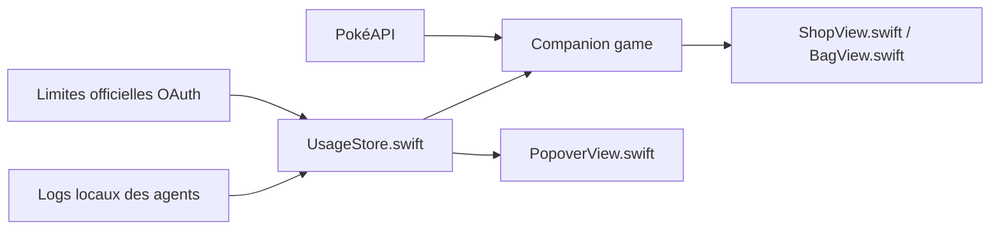

# chattymin/PokeTokenBar

> macOS menu bar app that tracks coding agents' token consumption and turns it into a Pokémon game.

## The problem
Knowing your token spend and your 5-hour / weekly limits requires opening dashboards or reading logs.

## What it actually does
Reads the logs of about ten agents locally (Claude Code, Codex, Gemini CLI, Cursor, OpenCode…) and displays today's usage, cost, official limits with countdown and a forecast of the consumption pace. Tokens hatch and evolve Pokémon (PokéAPI data), with shop, Pokédex and a floating pet. Claude limits go through an unofficial endpoint.

## How it is wired


## Trying it
```bash
brew install --cask chattymin/tap/poke-token-bar
swift build
swift test
./scripts/build-app.sh
```

## Cost and gotchas
Free, macOS 14+. App not notarized. Contacts twelve hosts, including PokéAPI, api.anthropic.com and cursor.com, without sending the logs according to the README. The Keychain is read only on manual refresh.

## What it is not
Not a reliable billing tool: Kiro is estimated, and costs depend on local logs. Unofficial, non-commercial fan project.

## Alternatives
No alternative named in the README.

## For you
Worth watching: useful for keeping an eye on your token consumption on a Mac, but the game aspect and the unofficial endpoint make it fragile.
