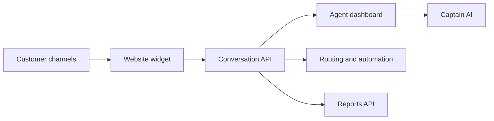

# chatwoot/chatwoot

> Open-source, self-hostable customer support platform, an alternative to Intercom or Zendesk.

## The problem
Centralizing customer conversations from several channels without entrusting your data to a closed SaaS.

## What it actually does
Omnichannel inbox (web widget, messaging channels), agent dashboard, routing and automation, campaigns, help center, reports and CSAT. A "Captain AI" component (query translation, LLM service) is mentioned. Code-level detail is not provided: internal wiring is undocumented.

## How it is wired

## Trying it
No command documented in the README (deployment via Heroku button, DigitalOcean Kubernetes, deployment page).

## Cost and gotchas
Hosting is on you; Heroku or DigitalOcean if you choose one-click deployment. Environment variables must be set, otherwise "things break" according to the README.

## What it is not
Not a data/AI tool: it is a business helpdesk application. License present but not identified by GitHub, to be read before any commercial use.

## Alternatives
The alternatives cited are SaaS products (Intercom, Zendesk, Salesforce Service Cloud): more support, but closed.

## For you
Ignore for a data/AI/MLOps profile: off topic, unless you are setting up customer support yourself.
