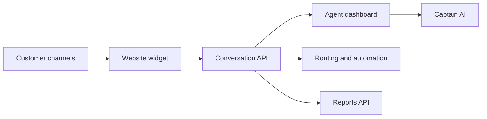

# chatwoot/chatwoot

> Plateforme de support client open source et auto-hébergeable, alternative à Intercom ou Zendesk.

## Le problème
Centraliser les conversations clients de plusieurs canaux sans confier ses données à un SaaS fermé.

## Ce que ça fait vraiment
Boîte de réception omnicanale (widget web, canaux de messagerie), tableau de bord agent, routage et automatisation, campagnes, centre d'aide, rapports et CSAT. Une brique « Captain AI » (traduction de requêtes, service LLM) est citée. Le détail du code n'est pas fourni : câblage interne non documenté.

## Comment c'est branché

## Essayer
Aucune commande documentée dans le README (déploiement par bouton Heroku, Kubernetes DigitalOcean, page de déploiement).

## Coût et pièges
Hébergement à ta charge ; Heroku ou DigitalOcean si tu choisis le déploiement en un clic. Variables d'environnement à régler, sinon « des casses » selon le README.

## Ce que ce n'est pas
Pas un outil data/IA : c'est une application métier de helpdesk. Licence présente mais non identifiée par GitHub, à lire avant tout usage commercial.

## Alternatives
Les alternatives citées sont des SaaS (Intercom, Zendesk, Salesforce Service Cloud) : plus de support, mais fermées.

## Pour toi
À ignorer pour un profil data/IA/MLOps : hors sujet, sauf si tu montes toi-même un support client.

