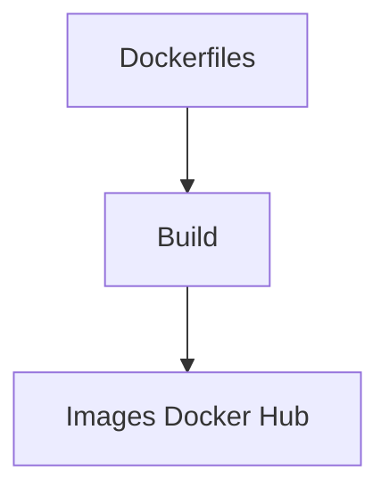

# chatwork/dockerfiles

> Dockerfiles of the images published by Chatwork on Docker Hub.

## The problem
Not documented: the README describes no need.

## What it actually does
Contains the Dockerfiles of the images Chatwork publishes on Docker Hub. Issues and feature requests are filed on the repo, and pull requests are accepted there. The list of images is not given in the README.

## How it is wired
Simplified diagram based on the fiche, no diagram provided.


## Trying it
```bash
# Aucune commande documentée.
```

## Cost and gotchas
Free. The content of the images is not described: check the Dockerfiles before use.

## What it is not
Not a documented catalog of images: the README does not say which ones exist or what they are for.

## Alternatives
No alternative named in the README.

## For you
To ignore: insufficient material to judge, and nothing points to a link with data, AI or MLOps.
