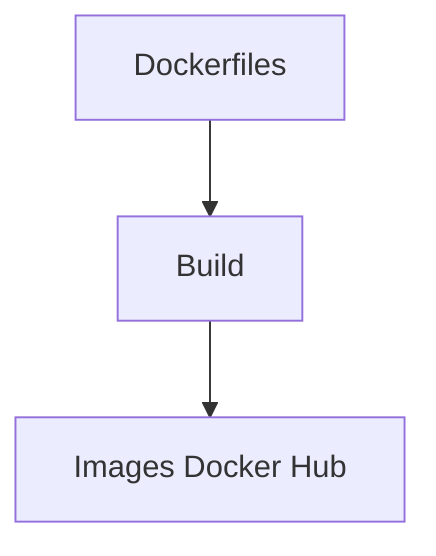

# chatwork/dockerfiles

> Dockerfiles des images publiées par Chatwork sur Docker Hub.

## Le problème
Non documenté : le README ne décrit aucun besoin.

## Ce que ça fait vraiment
Contient les Dockerfiles des images que Chatwork publie sur Docker Hub. Les issues et demandes de fonctions se déposent sur le dépôt, les pull requests y sont acceptées. La liste des images n'est pas donnée dans le README.

## Comment c'est branché
Schéma simplifié d'après la fiche, sans diagramme fourni.


## Essayer
```bash
# Aucune commande documentée.
```

## Coût et pièges
Gratuit. Le contenu des images n'est pas décrit : à vérifier dans les Dockerfiles avant usage.

## Ce que ce n'est pas
Pas un catalogue documenté d'images : le README ne dit pas lesquelles existent ni à quoi elles servent.

## Alternatives
Aucune alternative nommée dans le README.

## Pour toi
À ignorer : matière insuffisante pour juger, et rien n'indique un lien avec la data, l'IA ou le MLOps.

