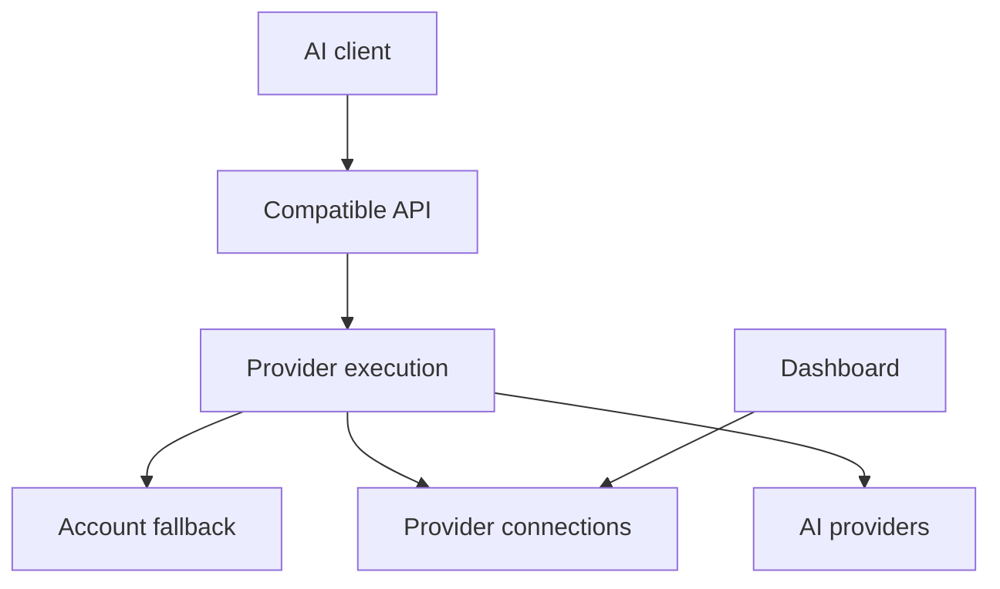

# cheaper-inference/OmniRoute

> Self-hosted AI gateway: an OpenAI-compatible access point that routes to hundreds of providers, including those offering free services.

## The problem
Accumulating free quotas or subscriptions from multiple providers requires managing multiple SDKs and limitations.

## What it actually does
A local server (port 20128) receives OpenAI-compatible requests, applies fallback, routing (20 strategies, including `auto` combinations), token quotas, and compression, and then calls the provider. The interface includes a dashboard and a command-line interface with over 80 commands, as well as MCP and A2A servers. You provide your own accounts; the free quotas advertised come from third-party providers.

## How it is wired


## Trying it
```bash
curl http://localhost:20128/v1/chat/completions \
  -H "Authorization: Bearer YOUR_OMNIROUTE_KEY" \
  -H "Content-Type: application/json" \
  -d '{"model":"auto","messages":[{"role":"user","content":"Hello!"}]}'
omniroute run claude --model openai/gpt-5.4
```
Installation instructions: `npm install -g omniroute` (README truncated beyond this point).

## Cost and gotchas
The tool itself is free, but each provider sets its own limits and conditions. Some require a card or proof of identity. A provider without a key may refuse to work with third-party clients.

## What it is not
This is not a statement about free token credits: the figure of 1.62 billion per month is an aggregated estimate of free tiers, which can fluctuate in both directions.

## Alternatives
The README mentions 9router, OpenRouter, CLIProxyAPI, and LiteLLM for comparison, but does not elaborate on the reasons for preferring them here.

## For you
Things to watch out for: useful for assigning tasks to your agents based on free quotas, but a very recent project (501 open issues) maintained by a single person.
