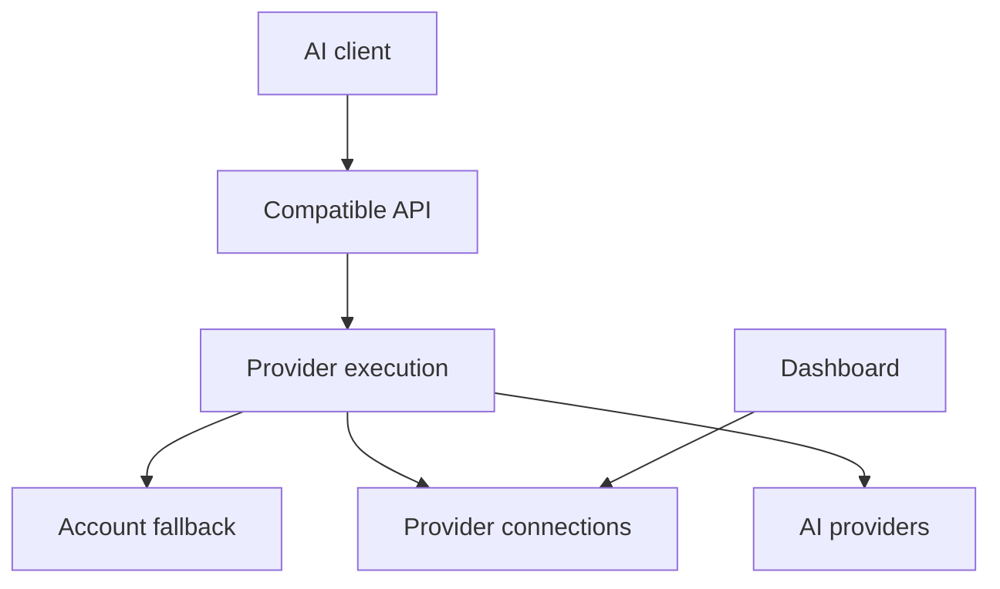

# cheaper-inference/OmniRoute

> Passerelle IA auto-hébergée : un point d'accès compatible OpenAI qui route vers des centaines de fournisseurs, dont des offres gratuites.

## Le problème
Cumuler des quotas gratuits ou abonnements chez plusieurs fournisseurs oblige à jongler avec autant de SDK et de limites.

## Ce que ça fait vraiment
Un serveur local (port 20128) reçoit des requêtes OpenAI-compatibles, applique fallback, routage (20 stratégies, combos `auto`), quotas et compression de tokens, puis appelle le fournisseur. Tableau de bord, CLI de plus de 80 commandes, serveur MCP et A2A. Tu apportes tes propres comptes : les quotas gratuits annoncés viennent des fournisseurs tiers.

## Comment c'est branché


## Essayer
```bash
curl http://localhost:20128/v1/chat/completions \
  -H "Authorization: Bearer YOUR_OMNIROUTE_KEY" \
  -H "Content-Type: application/json" \
  -d '{"model":"auto","messages":[{"role":"user","content":"Hello!"}]}'
omniroute run claude --model openai/gpt-5.4
```
Installation indiquée : `npm install -g omniroute` (README tronqué au-delà).

## Coût et pièges
Gratuit côté outil, mais chaque fournisseur impose ses limites et ses conditions ; certains exigent une carte ou une vérification d'identité. Un fournisseur sans clé peut refuser les clients tiers.

## Ce que ce n'est pas
Ce n'est pas un crédit de tokens offert : le chiffre de 1,62 milliard par mois est une estimation agrégée de paliers gratuits tiers, qui bougent dans les deux sens.

## Alternatives
Le README cite 9router, OpenRouter, CLIProxyAPI et LiteLLM pour la comparaison, sans détailler ici pourquoi les préférer.

## Pour toi
À surveiller : utile pour router tes agents sur des quotas gratuits, mais projet très récent (501 issues ouvertes) tenu par une personne.

