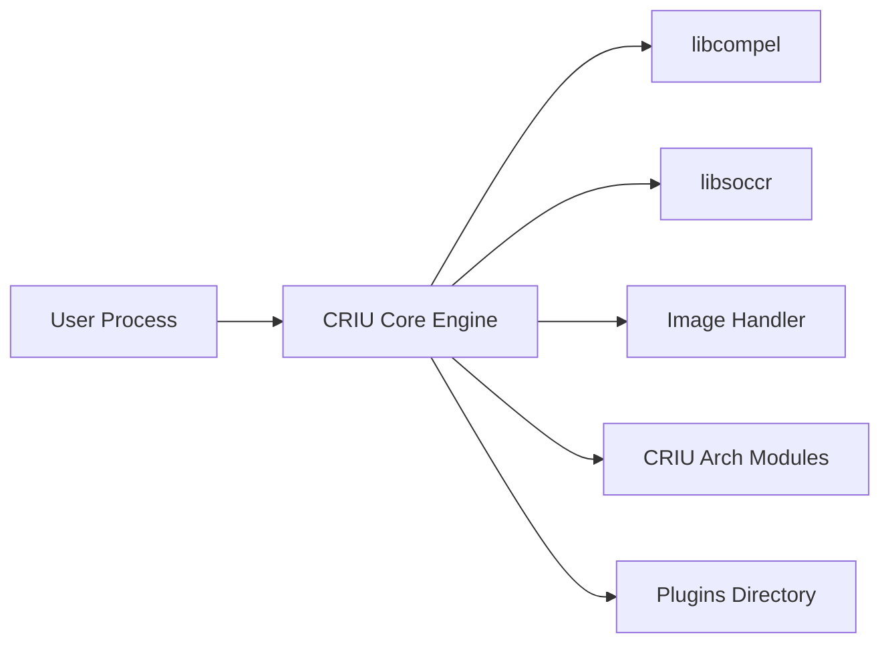

# checkpoint-restore/criu

> Linux utility that freezes a running process, saves it to disk and then restores it, for system administrators.

## The problem
Moving or resuming a Linux process without losing its state (memory, descriptors, TCP connections) forces you to restart the application.

## What it actually does
Injects "parasite" code (libcompel) into the process to read its state, writes image files (memory, open files), and restores later, TCP included via libsoccr. Per-architecture code (x86, ARM, MIPS, RISC-V...) and plugins (amdgpu, cuda). Integrated with OpenVZ, LXC/LXD and Docker according to the README.

## How it is wired

## Trying it
No command in the README: installation and examples point to the criu.org wiki.

## Cost and gotchas
Free. Requires a compatible Linux kernel; coverage depends on kernel features. License flagged "present but unidentified" by GitHub: read it in the repository.

## What it is not
Not a container tool in itself: a building block that others integrate. Not cross-platform: Linux only.

## Alternatives
The README mentions "other checkpoint/restore projects for Linux" without naming them.

## For you
Watch it: used to resume or migrate long jobs or GPU training via plugins; niche, to keep in mind for MLOps.
