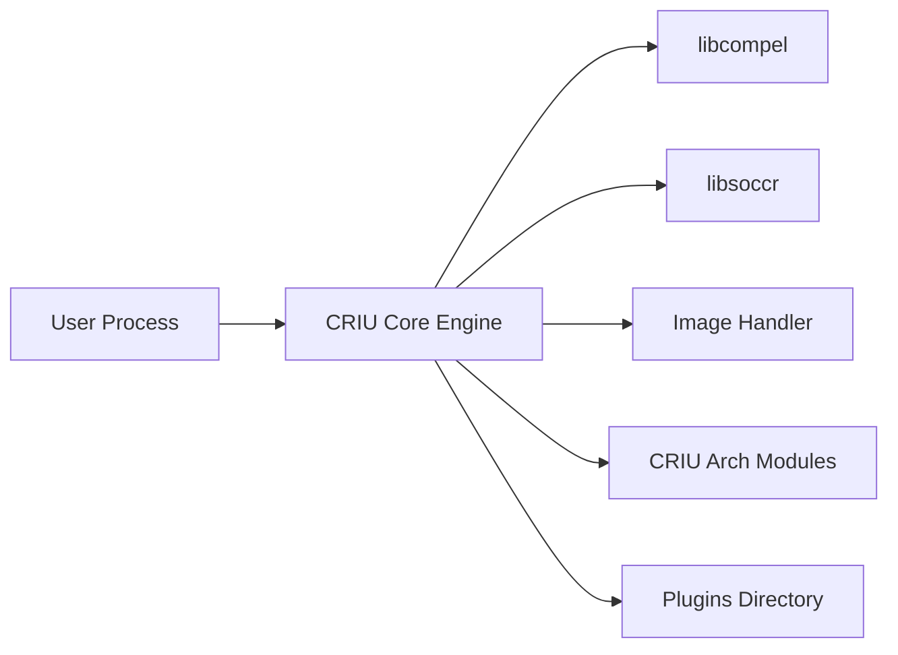

# checkpoint-restore/criu

> Utilitaire Linux qui fige un processus en cours, le sauvegarde sur disque puis le restaure, pour administrateurs système.

## Le problème
Déplacer ou reprendre un processus Linux sans perdre son état (mémoire, descripteurs, connexions TCP) oblige à redémarrer l'application.

## Ce que ça fait vraiment
Injecte du code « parasite » (libcompel) dans le processus pour lire son état, écrit des fichiers image (mémoire, fichiers ouverts), et restaure plus tard, TCP compris via libsoccr. Code par architecture (x86, ARM, MIPS, RISC-V…) et plugins (amdgpu, cuda). Intégré à OpenVZ, LXC/LXD et Docker d'après le README.

## Comment c'est branché

## Essayer
Aucune commande dans le README : installation et exemples renvoient au wiki criu.org.

## Coût et pièges
Gratuit. Exige un noyau Linux compatible ; la couverture dépend des fonctions du noyau. Licence marquée « présente mais non identifiée » par GitHub : à lire dans le dépôt.

## Ce que ce n'est pas
Pas un outil de conteneurs en soi : une brique que d'autres intègrent. Pas multiplateforme : Linux uniquement.

## Alternatives
Le README mentionne « d'autres projets de checkpoint/restore pour Linux » sans les nommer.

## Pour toi
Surveiller : sert à reprendre ou migrer des jobs longs ou à l'entraînement sur GPU via plugins ; niche, à garder en tête pour le MLOps.

