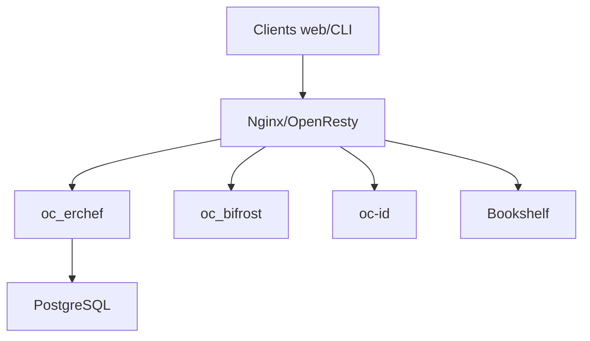

# chef/chef-server

> Central repository of the Chef Infra Server, which stores and serves machine configuration.

## The problem
Managing the configuration of a server fleet as code requires a central server for the API, authorization and cookbook storage.

## What it actually does
A set of services: `oc_erchef` (REST API in Erlang), `oc_bifrost` (authorization), `oc-id` (OAuth2), `bookshelf` (S3-compatible cookbook storage), `chef-server-ctl` (administration). Backed by PostgreSQL, Redis, Elasticsearch, nginx/openresty and runit. Omnibus packages and Habitat images.

## How it is wired


## Trying it
```bash
cd omnibus/
make dev dev-build
docker-compose up
docker-compose exec chef-server-ctl chef-server-test
```

## Cost and gotchas
Heavy: PostgreSQL, Redis, Elasticsearch, Vagrant or Docker for development. 324 open issues.

## What it is not
Not the Chef client (another repository): this is the server. Not a data tool.

## Alternatives
No alternative named in the README.

## For you
Ignore: server configuration administration, outside the data/AI scope, and Chef has been superseded for most modern MLOps uses (undocumented assessment).
