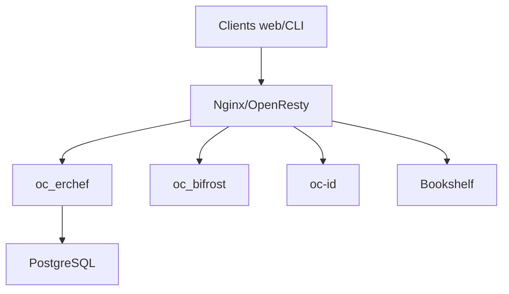

# chef/chef-server

> Dépôt central du Chef Infra Server, qui stocke et sert la configuration des machines.

## Le problème
Gérer par code la configuration d'un parc de serveurs demande un serveur central d'API, d'autorisation et de stockage de cookbooks.

## Ce que ça fait vraiment
Un ensemble de services : `oc_erchef` (API REST en Erlang), `oc_bifrost` (autorisation), `oc-id` (OAuth2), `bookshelf` (stockage compatible S3 des cookbooks), `chef-server-ctl` (administration). Appuyé sur PostgreSQL, Redis, Elasticsearch, nginx/openresty et runit. Paquets Omnibus et images Habitat.

## Comment c'est branché


## Essayer
```bash
cd omnibus/
make dev dev-build
docker-compose up
docker-compose exec chef-server-ctl chef-server-test
```

## Coût et pièges
Lourd : PostgreSQL, Redis, Elasticsearch, Vagrant ou Docker pour le développement. 324 issues ouvertes.

## Ce que ce n'est pas
Pas le client Chef (autre dépôt) : c'est le serveur. Pas un outil de données.

## Alternatives
Aucune alternative nommée dans le README.

## Pour toi
Ignorer : administration de configuration de serveurs, hors périmètre data/IA, et Chef est supplanté pour la plupart des usages MLOps modernes (appréciation non documentée).

