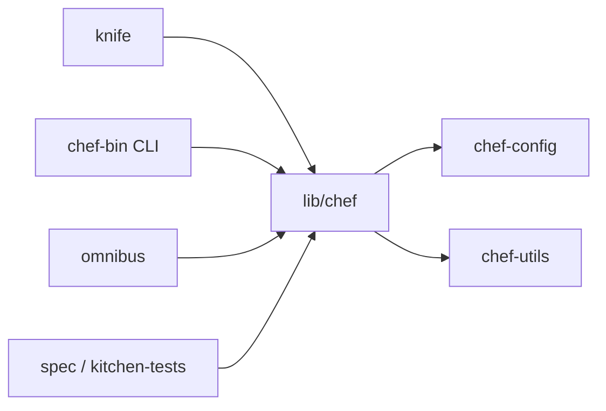

# chef/chef

> Chef Infra configuration management tool, for automating servers and infrastructure.

## The problem
Configuring server fleets by hand ends up with machines that drift apart.

## What it actually does
The README is mostly an index. From the code architecture: a client written in Ruby that reads recipes (DSL), evaluates the node's state and converges the resources; `knife` drives cookbooks and the Chef server; an Omnibus system assembles the packages. Monthly release cycle, annual major.

## How it is wired

## Trying it
No command documented: the README points to Learn Chef and to the documentation.

## Cost and gotchas
Free. Announced response time of 14 days for tickets and pull requests. Other Chef products have their own repositories.

## What it is not
Not a model deployment tool: it configures machines. The README gives no installation details.

## Alternatives
- No alternative named in the README.

## For you
Ignore: general-purpose server configuration management, far from your MLOps needs, which go through containers instead.
