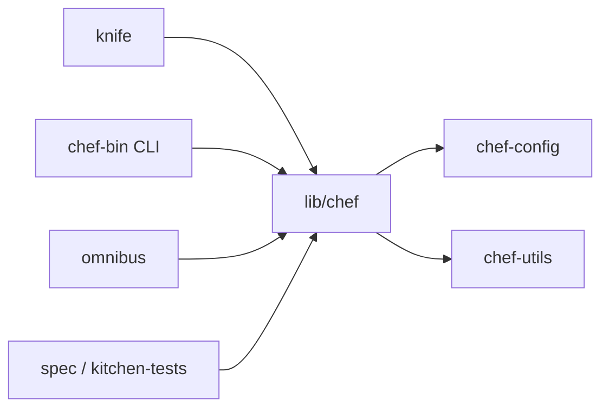

# chef/chef

> Outil de gestion de configuration Chef Infra, pour automatiser serveurs et infrastructure.

## Le problème
Configurer à la main des parcs de serveurs aboutit à des machines qui divergent.

## Ce que ça fait vraiment
Le README est surtout un index. D'après l'architecture du code : un client écrit en Ruby qui lit des recettes (DSL), évalue l'état du nœud et converge les ressources ; `knife` pilote les cookbooks et le serveur Chef ; un système Omnibus assemble les paquets. Cycle de versions mensuel, majeur annuel.

## Comment c'est branché

## Essayer
Aucune commande documentée : le README renvoie à Learn Chef et à la documentation.

## Coût et pièges
Gratuit. Délai de réponse annoncé de 14 jours pour tickets et pull requests. Les autres produits Chef ont leurs propres dépôts.

## Ce que ce n'est pas
Pas un outil de déploiement de modèles : il configure des machines. Le README ne donne pas de détails d'installation.

## Alternatives
- Aucune alternative nommée dans le README.

## Pour toi
À ignorer : gestion de configuration serveur généraliste, loin de tes besoins MLOps qui passent plutôt par des conteneurs.

