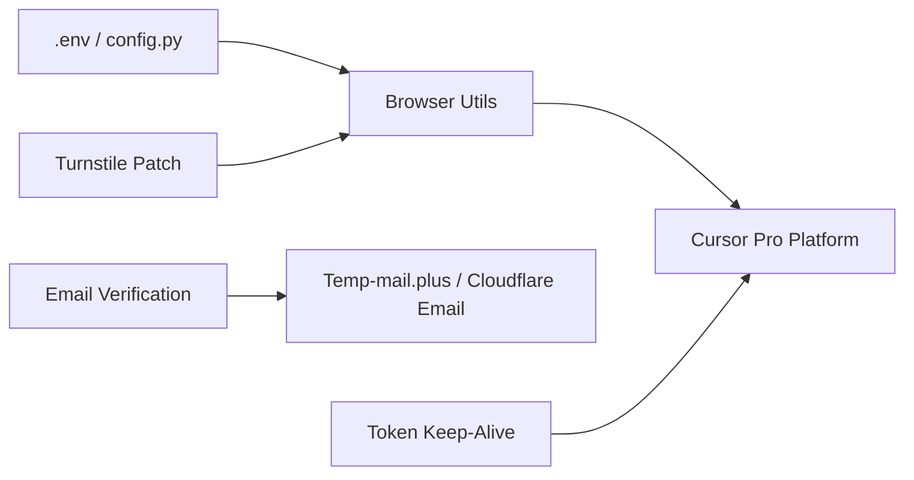

# chengazhen/cursor-auto-free

> Python script that automates Cursor Pro account sign-ups and token refreshes to get around subscription limits.

## The problem
The author wanted to avoid the limits of a paid subscription to the Cursor editor by automatically recreating accounts.

## What it actually does
According to the architecture described: an authentication manager (`cursor_auth_manager.py`), a reader for email verification codes (`get_email_code.py`, via Cloudflare Email or Temp-mail.plus), Chrome automation (`browser_utils.py`) with a Turnstile patch, and a token keep-alive service (`cursor_pro_keep_alive.py`). The README itself states that the project is obsolete and unmaintained.

## How it is wired

## Trying it
The README contains no commands: it points to online documentation. No command carried over.

## Cost and gotchas
Archived repository, no license declared in the catalog (the README mentions CC BY-NC-ND 4.0, a contradiction to verify). Getting around a subscription exposes you to a violation of the terms of service and to account blocking.

## What it is not
It is not a development tool nor a Cursor client: it is a workaround for commercial restrictions, which the author now advises against.

## Alternatives
The README recommends Claude Code / Codex as the official solution.

## For you
Ignore: archived, abandoned by its author, and its purpose (getting around a subscription) is risky and of no value for a data/AI profile.
