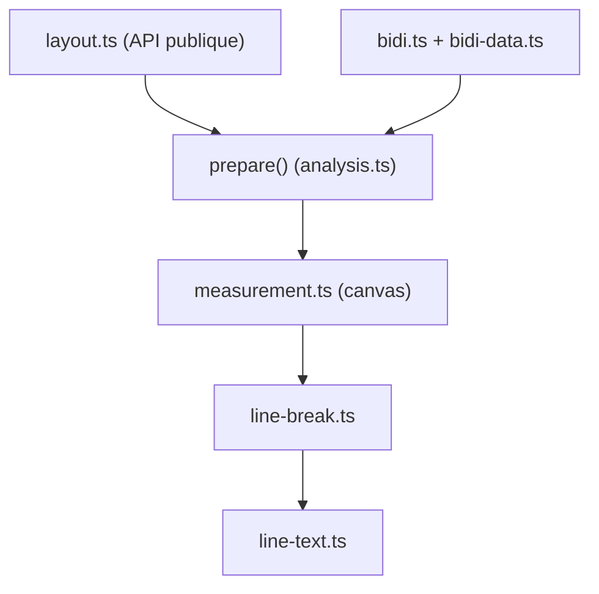

# chenglou/pretext

> A JavaScript library that measures and breaks multiline text without going through the DOM, for web interfaces.

## The problem
Measuring a paragraph's height through the DOM triggers costly layout recalculations in the browser.

## What it actually does
`prepare()` analyzes the text once (segmentation, canvas measurement), then `layout()` computes height and line count with simple arithmetic. Other functions return lines one by one, handle rich text (bullets, mentions, images) and bidirectional text. The browser's font engine serves as the reference.

## How it is wired


## Trying it
```bash
npm install @chenglou/pretext
bun install
bun start
```

## Cost and gotchas
Free. A Canvas 2D context is required: without a browser (Node, Bun, jsdom), `prepare()` fails unless a measurement is supplied. System fonts are unreliable on macOS. Repo created in March 2026. The README is cut off mid-line: the end was not read.

## What it is not
Not a full font rendering engine nor a CSS engine: it targets a few common settings (`white-space`, `word-break`).

## Alternatives
No alternative named in the README.

## For you
Ignore: a front-end layout tool, unrelated to your data or AI work.
