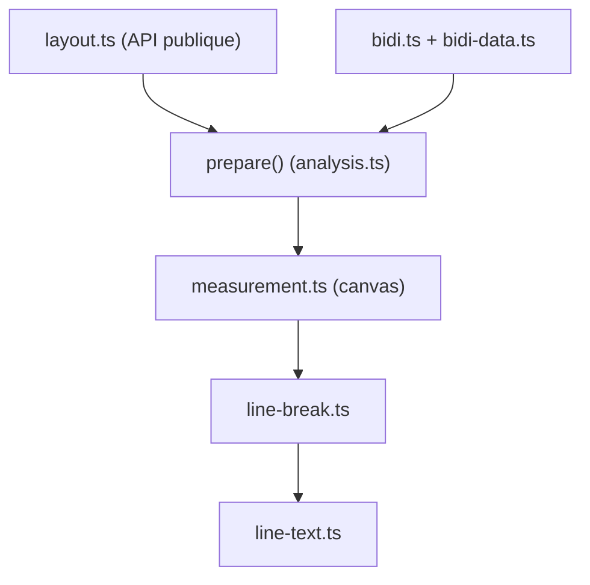

# chenglou/pretext

> Bibliothèque JavaScript qui mesure et découpe du texte multiligne sans passer par le DOM, pour interfaces web.

## Le problème
Mesurer la hauteur d'un paragraphe via le DOM déclenche des recalculs de mise en page coûteux dans le navigateur.

## Ce que ça fait vraiment
`prepare()` analyse le texte une fois (segmentation, mesure sur canvas), puis `layout()` calcule hauteur et nombre de lignes par simple arithmétique. D'autres fonctions renvoient les lignes une à une, gèrent le texte riche (puces, mentions, images) et le bidirectionnel. Le moteur de police du navigateur sert de référence.

## Comment c'est branché


## Essayer
```bash
npm install @chenglou/pretext
bun install
bun start
```

## Coût et pièges
Gratuit. Il faut un contexte Canvas 2D : sans navigateur (Node, Bun, jsdom), `prepare()` échoue sauf mesure fournie. Les polices système sont peu sûres sur macOS. Dépôt créé en mars 2026. Le README est coupé en cours de ligne : la fin n'a pas été lue.

## Ce que ce n'est pas
Pas un moteur de rendu de police complet ni un moteur CSS : il cible quelques réglages courants (`white-space`, `word-break`).

## Alternatives
Aucune alternative nommée dans le README.

## Pour toi
À ignorer : outil de mise en page front-end, sans rapport avec ton travail data ou IA.

